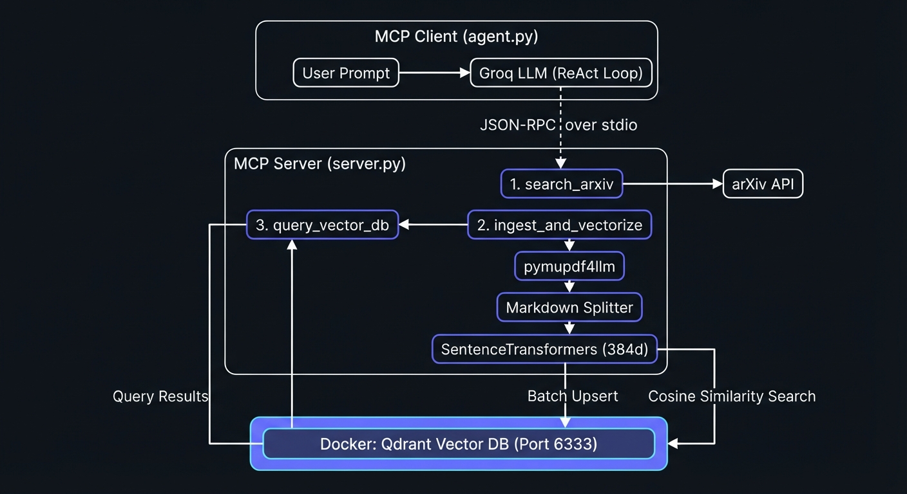

# 🧠 Autonomous AI Research Analyst (MCP + Vector DB)

An end-to-end, autonomous AI research assistant built using the **Model Context Protocol (MCP)**, **Dockerized Qdrant Vector Database**, and a **ReAct (Reasoning + Acting) Agent loop**. 

Instead of relying on static knowledge, this agent dynamically searches live academic repositories (arXiv), parses complex multi-column PDFs into structured Markdown, chunks them hierarchically by document sections, generates local embeddings, and performs semantic retrieval to synthesize cited research reports.

---

## 🏗️ System Architecture

This project decouples the **Agentic Reasoning Layer (Client)** from the **Data Ingestion & Retrieval Microservice (Server)** using the industry-standard **Model Context Protocol (MCP)** over standard input/output (`stdio`).




---

## 🛠️ Key Engineering Decisions & Features

* **Decoupled Microservice Architecture (FastMCP):** Tools are exposed via `@mcp.tool()` decorators, making the research backend completely modular and pluggable into custom Python agents, Claude Desktop, or Cursor.
* **Layout-Aware Hierarchical Chunking:** Standard character splitters destroy tabular data and sever context. This pipeline uses `pymupdf4llm` to convert PDFs into structured Markdown—preserving complex statistical tables—followed by `MarkdownHeaderTextSplitter` to anchor every chunk with its parent section hierarchy (`Section > Subsection`).
* **Local Privacy-First Embeddings:** Uses HuggingFace's `all-MiniLM-L6-v2` (`SentenceTransformers`) to generate 384-dimensional dense vector embeddings locally without external embedding API costs.
* **Production Vector Storage:** Connects asynchronously (`AsyncQdrantClient`) to a containerized Qdrant instance running on Docker, storing text chunks alongside rich metadata payloads (`source` URL and `section` headers) to guarantee accurate citations and prevent hallucinations.

---

## 🚀 Tech Stack

* **Agent Orchestration:** Python, Groq Cloud API (`openai/gpt-oss-120b`), Custom ReAct Loop
* **Protocol & Microservice:** `fastmcp`, `mcp` (Model Context Protocol SDK)
* **Vector Database:** Qdrant (Running via Docker)
* **Document Parsing & Chunking:** `pymupdf4llm`, `langchain-text-splitters`
* **Embeddings:** `sentence-transformers` (`all-MiniLM-L6-v2`)
* **Package Management:** `uv`

---

## ⚙️ Local Setup & Installation

### 1. Prerequisites
* Python 3.11+
* [Docker Desktop](https://docker.com)
* [`uv`](https://astral.sh) package manager

### 2. Spin Up Qdrant in Docker
Run a local Qdrant container exposed on port `6333`:
```bash
docker run -p 6333:6333 -p 6334:6334 -v qdrant_storage:/qdrant/storage qdrant/qdrant
```

### 3. Clone & Install Dependencies
```bash
git clone https://github.com
cd autonomous-research-analyst-mcp

# Sync virtual environment and install packages
uv sync
```

### 4. Set Environment Variables
Set your Groq API key in your terminal session:
```powershell
# Windows PowerShell
\$env:MY_API_KEY_AI="gsk_your_api_key_here"
```

### 5. Run the Autonomous Agent
```bash
uv run python agent.py
```

---

## 📊 Sample Execution & Results

**User Query:** 
> *"Find a paper on climate change parameters in India, save it, and tell me the predicted carbon dioxide emission values for 2035."*

**Agent Execution Trace:**
1. **`[Cycle 1]`** Agent invokes `search_arxiv(query="climate change parameters India")`.
2. **`[Cycle 2]`** Agent selects *"Analysis of various climate change parameters in India using machine learning"* (`arXiv:2201.10123`) and executes `ingest_and_vectorize()`.
3. **`[Cycle 3]`** Server parses the PDF into Markdown, preserving **Table II (Model Accuracy)** and **Table III (Predictions)**, and upserts the vectors into Qdrant.
4. **`[Cycle 4]`** Agent invokes `query_vector_db(query="2035 carbon dioxide emission predicted values")`.
5. **`[Cycle 5]`** Agent synthesizes the retrieved tabular metrics into the final report:

> **Final Synthesized Output:**
> Based on the paper *"Analysis of various climate change parameters in India using machine learning"* (`https://arxiv.org`), the projected 2035 values derived from Exponential Regression models are:
> * **Total Carbon Dioxide ($CO_2$) Emissions (Parameter 7):** `5,801,529.111` kilotons *(Model $R^2$ accuracy: `0.997`)*
> * **Total Greenhouse Gas Emissions (Parameter 11):** `5,446,579.740` kilotons of $CO_2$ equivalent *(Model $R^2$ accuracy: `0.988`)*

---

## 🔮 Future Improvements
* **Hybrid Search:** Combine Qdrant dense vector search with sparse keyword search (BM25) to improve retrieval on exact acronyms and chemical formulas.
* **Multimodal Vision RAG:** Integrate a vision-language model to generate text descriptions of embedded matplotlib/seaborn charts and graphs.
